  

I'm a student at the University of Information Technology (UIT), VNU-HCM, learning computer vision, especially multimedia retrieval, and retrieval-augmented generation (RAG).

### Highlights

- **Olympic AI for Students 2026, Southern regional round: First Prize** with team UIT-Kitchen_1, ranked 2nd in the South and 3rd nationwide across the regional rounds.
- **AI City Challenge 2026, Track 2: Runner-up**, as a member of team UIT-Kitchen.
- **Ho Chi Minh City AI Challenge 2026: Potential Prize** with team UIT-Kitchen. Our system was accepted at SOICT 2026 as *Seeing the Small Things: Tiled CCTV Search in an Interactive Multimodal Video Retrieval System*, with me as first author.

### Projects

| Project | What it does | Result |
|---|---|---|
| [AI City Challenge 2026, Track 2](https://github.com/jlonggg/aicity2026-track2) | Describes traffic-safety videos and answers questions about them, using LoRA adapters on Qwen3.5-9B trained only on the synthetic SynWTS set | Runner-up, VQA accuracy ≈ 84.7 on the public test |
| [UIT Data Science Challenge 2026: Legal QA](https://github.com/jlonggg/uitdsc26_legalqa) | Answers Vietnamese legal questions by quoting the right article: BM25 and dense retrieval, cross-encoder reranking, then listwise reranking with jina-reranker-v3.5, all zero-shot | Rank 2 on the private test, METEOR 0.6433 |
| [UIT Data Science Challenge 2026: Legal IR](https://github.com/jlonggg/uitdsc26_legalir) | Finds the legal documents relevant to each question: BM25 plus three dense channels, LoRA-tuned rerankers with multiple-instance learning, and a LightGBM ranker on top | Rank 8 on the private test, recall 0.9515 |

### Tools I use

Python, PyTorch, Hugging Face Transformers, PEFT (LoRA), sentence-transformers, Elasticsearch, LightGBM, OpenCV, Docker.
